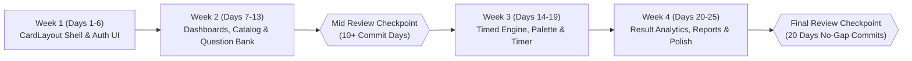
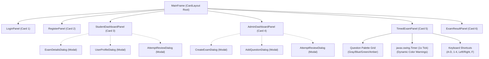

# 📋 Qveto Technologies — 25-Day Frontend Engineering Task Sheet
### Role: Member 1 (Frontend & UI/UX Engineer)
**Project 3: Online Examination System** | **Technology Stack: Java 17/21, Java Swing, CardLayout, javax.swing.Timer, Maven**  
**SOP Reference:** Standard Operating Procedures for Intern Projects — Version 1.1

---

## 🎯 Executive Summary & Compliance Mandate

This 25-day task sheet outlines the end-to-end user interface architecture, screen development lifecycle, state machine, and accessibility engineering for **Member 1 (Frontend & UI/UX Specialist)**. It is calibrated to meet **Qveto Technologies SOP v1.1** compliance requirements:

- **Dedicated Branch**: Member 1 operates and commits daily to branch: `feature/member-1-frontend-ui`
- **Mid Review Compliance (Days 1–13 / 8th–20th)**: Minimum **10 distinct commit days** required before Mid Review.
- **Final Review Compliance (Days 14–25 / 21st–2nd next month)**: Minimum **20 cumulative days with daily commits (no gaps permitted)**.
- **Architecture Scope**: Clean presentation layer (`com.qveto.exam.ui`), centralized `CardLayout` routing on `MainFrame`, reactive countdown timers with `javax.swing.Timer`, Question Palette state transitions (Unanswered, Current, Answered, Flagged), keyboard accessibility shortcuts, input validation, and standalone mock fallback.

---

## 🗓️ 25-Day Daily Breakdown Table

| Day | Cycle Date | Phase | Task & Technical Deliverable | Primary File(s) | Commit Type & Message | Status |
| :---: | :---: | :---: | :--- | :--- | :--- | :---: |
| **01** | 8th | W1: Foundation | Analyze UI requirements, draft screen mockups, state transition diagrams, and navigation flowcharts. | `docs/ui_wireframes.md` | `docs(ui): draft user journey wireframes and navigation flow` | ✔ Completed |
| **02** | 9th | W1: Foundation | Define design token constants (`AppConstants.java`): color palette (`#1E3A8A`, `#0284C7`, `#10B981`), typography, card layout IDs. | `src/.../util/AppConstants.java` | `feat(ui): define design system tokens and typography constants` | ✔ Completed |
| **03** | 10th | W1: Foundation | Implement `MainFrame.java` hosting root `CardLayout` router and screen coordinator. | `src/.../ui/MainFrame.java` | `feat(ui): implement master CardLayout navigation container` | ✔ Completed |
| **04** | 11th | W1: Foundation | Implement `LoginPanel.java` with role routing (Admin vs Student), connection status badge, and demo quick-fill buttons. | `src/.../ui/LoginPanel.java` | `feat(ui): implement LoginPanel with quick-fill demo credentials` | ✔ Completed |
| **05** | 12th | W1: Foundation | Implement `RegisterPanel.java` with client-side regex format checking and password confirmation. | `src/.../ui/RegisterPanel.java` | `feat(ui): implement RegisterPanel with input validation` | ✔ Completed |
| **06** | 13th | W1: Foundation | Implement `InputValidator.java` and `ValidationResult.java` for visual error feedback on forms. | `src/.../validation/InputValidator.java` | `feat(ui): implement visual input validation utilities` | ✔ Completed |
| **07** | 14th | W2: Dashboards | Implement `StudentDashboardPanel.java` available exams catalog table and instructions pane. | `src/.../ui/StudentDashboardPanel.java` | `feat(ui): implement candidate portal dashboard and exams catalog` | ✔ Completed |
| **08** | 15th | W2: Dashboards | Implement `ExamDetailsDialog.java` pre-exam modal showing syllabus, duration, marks, and rules. | `src/.../ui/ExamDetailsDialog.java` | `feat(ui): implement pre-exam syllabus and guidelines modal` | ✔ Completed |
| **09** | 16th | W2: Admin | Implement `AdminDashboardPanel.java` tabbed workspace for Exam Management, Question Bank, and Reports. | `src/.../ui/AdminDashboardPanel.java` | `feat(ui): implement AdminDashboardPanel tabbed interface` | ✔ Completed |
| **10** | 17th | W2: Admin | Implement `CreateExamDialog.java` modal for authoring exams with duration, question count, and pass score. | `src/.../ui/CreateExamDialog.java` | `feat(ui): implement CreateExamDialog modal for exam creation` | ✔ Completed |
| **11** | 18th | W2: Admin | Implement `AddQuestionDialog.java` modal for creating MCQs with 4 options and correct answer selector. | `src/.../ui/AddQuestionDialog.java` | `feat(ui): implement AddQuestionDialog for MCQ authoring` | ✔ Completed |
| **12** | 19th | W2: Profile | Implement `UserProfileDialog.java` for viewing student profile information and secure password update. | `src/.../ui/UserProfileDialog.java` | `feat(ui): implement UserProfileDialog for password updates` | ✔ Completed |
| **13** | 20th | **Mid Review** | **Mid-Review Checkpoint**: Add "Mark for Review" question flagging, keyboard navigation shortcuts, real-time catalog search filter, and `FrontendUITest.java`. | `TimedExamPanel.java`, `StudentDashboardPanel.java`, `FrontendUITest.java` | `feat(ui): add mark-for-review flagging, keyboard shortcuts, and UI test suite` | ✔ Completed |
| **14** | 21st | W3: Timed Exam | Implement `TimedExamPanel.java` live progress bar, completion percentage tracker, window-close/interruption safeguard, and session lifecycle abandonment handling. | `MainFrame.java`, `TimedExamPanel.java`, `FrontendUITest.java` | `feat(ui): implement live exam completion progress bar and window-close safeguard` | ✔ Completed |
| **15** | 22nd | W3: Timed Exam | Implement visible countdown timer with `javax.swing.Timer` (green -> amber -> red alert states), visual pulse alerts, and warning thresholds. | `TimedExamPanel.java`, `FrontendUITest.java` | `feat(ui): implement ticking countdown timer with warning colors and critical pulsing` | ✔ Completed |
| **16** | 23rd | W3: Timed Exam | Implement interactive Question Palette grid with real-time color states, glance accessibility badges (✓, ⚑, ★), live summary stats, and quick-jump navigation. | `TimedExamPanel.java`, `FrontendUITest.java` | `feat(ui): implement interactive question palette grid with quick jump and live statistics` | **[✔ Completed Today]** |
| **17** | 24th | W3: Timed Exam | Implement answer persistence: ensure selections persist when moving Next/Previous or jumping via palette. | `src/.../ui/TimedExamPanel.java` | `feat(ui): implement continuous answer persistence across navigation` | Scheduled |
| **18** | 25th | W3: Timed Exam | Implement confirmed manual submission dialog and automatic submission lock on timer expiry. | `src/.../ui/TimedExamPanel.java` | `feat(ui): implement dual submission controls and timeout lockdown` | Scheduled |
| **19** | 26th | W4: Results | Implement `ExamResultPanel.java` scorecard summary displaying score, percentage, and pass/fail banner. | `src/.../ui/ExamResultPanel.java` | `feat(ui): implement ExamResultPanel scorecard and pass/fail badge` | Scheduled |
| **20** | 27th | W4: Results | Implement question-by-question review table on the result screen without prematurely leaking answer keys. | `src/.../ui/ExamResultPanel.java` | `feat(ui): implement post-submission question review table` | Scheduled |
| **21** | 28th | W4: Analytics | Implement candidate assessment history table and `AttemptReviewDialog.java` for past attempt breakdown. | `AttemptReviewDialog.java`, `StudentDashboardPanel.java` | `feat(ui): implement attempt breakdown review dialog` | Scheduled |
| **22** | 29th | W4: Analytics | Implement administrator multi-filter candidate score analytics and CSV export trigger button. | `src/.../ui/AdminDashboardPanel.java` | `feat(ui): implement candidate analytics table and CSV export button` | Scheduled |
| **23** | 30th | W4: Polish | Refine UI styling, border radiuses, custom table cell renderers, and empty state placeholders. | `src/.../ui/*.java` | `style(ui): polish UI borders, custom table renderers, and spacing` | Scheduled |
| **24** | 1st | W4: Polish | Conduct end-to-end Swing usability testing, edge case handling (window resizing, rapid clicks, network disconnects). | `src/test/.../FrontendUITest.java` | `test(ui): add comprehensive edge-case and window resize UI tests` | Scheduled |
| **25** | 2nd | **Final Review**| **Final Review Sign-off**: Verify 20 consecutive commit days, clean git history, finalize `FRONTEND_ARCHITECTURE.md`, PR merge to `main`. | `FRONTEND_ARCHITECTURE.md`, `README.md` | `docs(review): finalize frontend engineering report for final review` | Scheduled |

---

## 🏛️ Frontend UI Architecture Overview

---

## 🛡️ Qveto SOP Compliance Checklist for Member 1

> [!IMPORTANT]
> **GitHub & Review Policy Rules for Frontend Specialist:**
> 1. **Dedicated Branch**: All frontend commits must originate from `feature/member-1-frontend-ui` before merging to `main`.
> 2. **Mid Review Gate (Days 1–13)**: Must maintain at least **10 distinct commit days** across Days 1–13.
> 3. **Final Review Gate (Days 14–25)**: Must demonstrate **20 consecutive commit days with zero gaps**.
> 4. **Swing EDT Thread Safety**: All UI updates and dialog instantiations must run on the Swing Event Dispatch Thread (`SwingUtilities.invokeLater`).
> 5. **Decoupled Architecture**: UI components must never execute raw JDBC queries directly; all operations must route through `AuthService` and `ExamService`.
