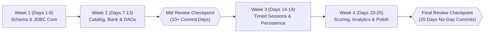
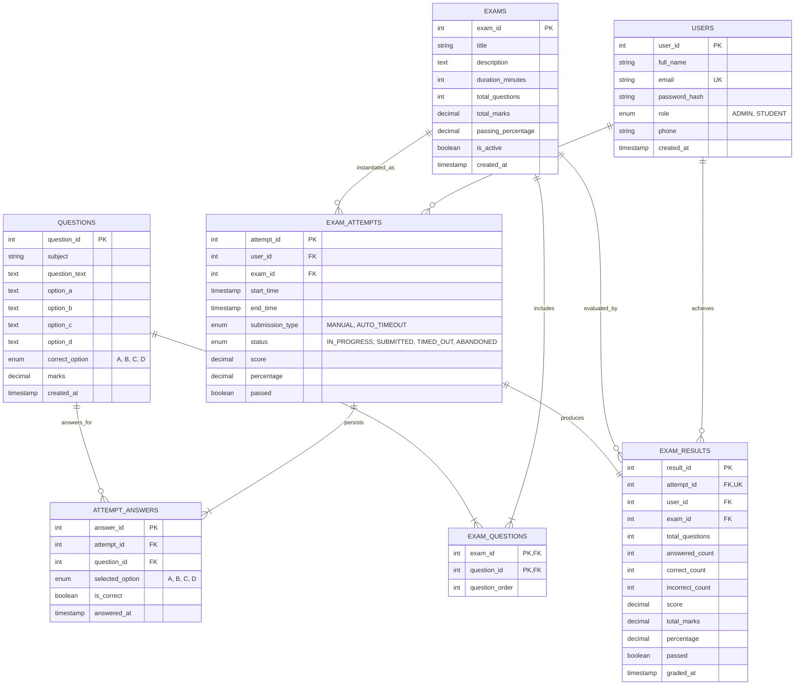

# 📋 Qveto Technologies — 25-Day Database Engineering Task Sheet
### Role: Member 2 (Database & Persistence Engineer)
**Project 3: Online Examination System** | **Technology Stack: Java, MySQL 8.x, JDBC, Maven**  
**SOP Reference:** Standard Operating Procedures for Intern Projects — Version 1.1

---

## 🎯 Executive Summary & Compliance Mandate

This 25-day task sheet outlines the end-to-end database engineering, data persistence, and JDBC architecture responsibilities for **Member 2 (Database Specialist)**. It is calibrated to meet **Qveto Technologies SOP v1.1** compliance requirements:

- **Dedicated Branch**: Member 2 operates and commits daily to branch: `feature/member-2-database-persistence`
- **Mid Review Compliance (Days 1–13 / 8th–20th)**: Minimum **10 distinct commit days** required before Mid Review.
- **Final Review Compliance (Days 14–25 / 21st–2nd next month)**: Minimum **20 cumulative days with daily commits (no gaps permitted)**.
- **Architecture Scope**: Relational schema DDL (7 tables), JDBC connection pooling, PreparedStatement security, 5 DAO classes, ACID transaction management for timed attempts, performance indexing, and analytical result reporting.

---

## 🗓️ 25-Day Daily Breakdown Table

| Day | Cycle Date | Phase | Task & Technical Deliverable | Primary File(s) | Commit Type & Message |
| :---: | :---: | :---: | :--- | :--- | :--- |
| **01** | 8th | W1: Foundation | Analyze Project 3 functional specifications; draft Data Dictionary and Entity Relationship boundaries. | `docs/data_dictionary.md` | `docs(db): draft schema requirements and data dictionary` |
| **02** | 9th | W1: Foundation | Design Conceptual and Logical Data Models; verify 3rd Normal Form (3NF) across candidates, exams, and attempts. | `docs/er_model.png` | `docs(db): finalize 3NF logical ER model diagram` |
| **03** | 10th | W1: Foundation | Write initial DDL for Core Master Tables (`users`, `exams`, `questions`) with constraints (`PK`, `UK`, `CHECK`). | `database/schema.sql` | `feat(db): implement core master tables DDL with constraints` |
| **04** | 11th | W1: Foundation | Write DDL for Session & Relationship Tables (`exam_questions`, `exam_attempts`, `attempt_answers`, `exam_results`). | `database/schema.sql` | `feat(db): implement attempt session and result relational DDL` |
| **05** | 12th | W1: Foundation | Implement `DBConnection.java` with externalized `db.properties`, driver loading, and standalone fallback logic. | `src/.../util/DBConnection.java`, `db.properties` | `feat(db): implement externalized JDBC connection utility` |
| **06** | 13th | W1: Foundation | Implement `UserDAO.java` for secure authentication queries, role validation, and PreparedStatement security. | `src/.../dao/UserDAO.java`, `UserDAOTest.java` | `feat(dao): implement UserDAO authentication and CRUD queries` |
| **07** | 14th | W2: Catalog | Implement `QuestionDAO.java` with MCQ CRUD operations (options A-D, verified correct answer, marks). | `src/.../dao/QuestionDAO.java` | `feat(dao): implement QuestionDAO for MCQ bank management` |
| **08** | 15th | W2: Catalog | Implement Many-to-Many question reuse architecture (`exam_questions`) and ordering logic in `QuestionDAO`. | `src/.../dao/QuestionDAO.java` | `feat(dao): add cross-exam question reuse and sequence queries` |
| **09** | 16th | W2: Catalog | Implement `ExamDAO.java` for exam publishing, duration/passing criteria, and active status toggling. | `src/.../dao/ExamDAO.java` | `feat(dao): implement ExamDAO for exam configuration and listing` |
| **10** | 17th | W2: Catalog | Implement user profile update queries and secure password update queries in `UserDAO`. | `src/.../dao/UserDAO.java` | `feat(dao): add profile and hashed password update queries` |
| **11** | 18th | W2: Catalog | Author comprehensive synthetic seed data (`seed.sql`) with admin, student accounts, and multi-subject MCQs. | `database/seed.sql` | `feat(db): author comprehensive synthetic seed dataset` |
| **12** | 19th | W2: Catalog | Develop automated DAO test suite (`DAOTest.java`) testing connection resilience, constraints, and rollbacks. **[✔ Completed & Verified]** | `src/test/.../DAOTest.java` | `test(dao): add transactional DAO unit test suite` |
| **13** | 20th | **Mid Review** | **Mid-Review Checkpoint**: Validate Week 1-2 deliverables, run full schema migration, document 10+ commit days. **[✔ Completed & Audited]** | `WEEK2_DELIVERABLES.md` | `docs(review): finalize Week 1-2 database audit for mid review` |
| **14** | 21st | W3: Sessions | Design session lifecycle state machine in DB (`IN_PROGRESS`, `SUBMITTED`, `TIMED_OUT`, `ABANDONED`). **[✔ Completed & Verified]** | `database/schema.sql`, `AttemptStatus.java`, `docs/SESSION_LIFECYCLE.md` | `refactor(db): refine attempt status and submission type enums` |
| **15** | 22nd | W3: Sessions | Implement `AttemptDAO.java` — `createAttempt()`, `getAttempt()`, and timestamp initialization. **[✔ Completed & Verified]** | `src/.../dao/AttemptDAO.java` | `feat(dao): implement AttemptDAO session creation and tracking` |
| **16** | 23rd | W3: Sessions | Implement real-time answer persistence query with `ON DUPLICATE KEY UPDATE` to prevent data loss. **[✔ Completed & Verified]** | `src/.../dao/AttemptDAO.java` | `feat(dao): implement dynamic answer upsert query for navigation` |
| **17** | 24th | W3: Sessions | Implement `getAnswersForAttempt()` and question palette status retrieval queries in `AttemptDAO`. **[✔ Completed & Verified]** | `src/.../dao/AttemptDAO.java` | `feat(dao): add bulk attempt answer retrieval for question palette` |
| **18** | 25th | W3: Sessions | Implement transactional attempt submission queries (`submitAttempt`, `timeoutAttempt`) with locking. **[✔ Completed & Verified]** | `src/.../dao/AttemptDAO.java` | `feat(dao): implement submission locking and auto-timeout update` |
| **19** | 26th | W3: Sessions | Implement ACID transaction safeguards (`setAutoCommit(false)`, rollback on error) during exam finalization. **[✔ Completed & Verified]** | `src/.../dao/AttemptDAO.java` | `feat(dao): enforce ACID transaction boundaries on submission` |
| **20** | 27th | W4: Scoring | Implement `ResultDAO.java` for storing graded outcomes, score, percentage, and pass/fail status. **[✔ Completed & Verified]** | `src/.../dao/ResultDAO.java` | `feat(dao): implement ResultDAO score calculation persistence` |
| **21** | 28th | W4: Scoring | Implement candidate assessment history queries and Admin multi-filter reporting queries in `ResultDAO`. | `src/.../dao/ResultDAO.java` | `feat(dao): add student history and admin analytical queries` |
| **22** | 29th | W4: Polish | Query optimization & index tuning: analyze `EXPLAIN` query plans, add composite indexes on foreign keys. | `database/schema.sql` | `perf(db): add composite indexes and optimize reporting queries` |
| **23** | 30th | W4: Polish | Implement CSV data export query pipeline for administrator score sheets and pass-rate analytics. | `src/.../dao/ResultDAO.java` | `feat(dao): implement CSV report streaming and analytics aggregation` |
| **24** | 1st | W4: Polish | Author automated database backup and restore shell scripts (`backup.sql`, `restore.bat`); verify zero-data-loss recovery. | `database/backup.sql`, `database/reset.bat` | `chore(db): create database backup and automated reset scripts` |
| **25** | 2nd | **Final Review**| **Final Review Sign-off**: Verify 20 consecutive commit days, clean git log, create DB setup documentation, PR merge. | `README.md`, `DB_SETUP.md` | `docs(review): finalize database engineering report for final review` |

---

## 🏛️ Database Architecture Overview

---

## 🛡️ Qveto SOP Compliance Checklist for Member 2

> [!IMPORTANT]
> **GitHub & Review Policy Rules to Remember:**
> 1. **Personal Branch Requirement:** All work must be committed directly to Member 2's dedicated feature branch (e.g. `feature/member-2-database-persistence`). Never commit directly to `main` until the Team Lead conducts the formal merge review.
> 2. **Mid Review Gate (Days 1–13):** Must demonstrate commits across at least **10 distinct days** in the 14 days preceding Mid Review.
> 3. **Final Review Gate (Days 14–25):** Must demonstrate commits on all **20 days** leading to the Final Review with **zero gaps allowed**.
> 4. **PreparedStatement Enforcement:** Absolutely zero SQL string concatenation. All parameters must use `?` placeholders to guarantee SQL injection immunity.
> 5. **No Secrets in Repo:** Keep `db.properties` sanitized. Never commit raw passwords to GitHub.
