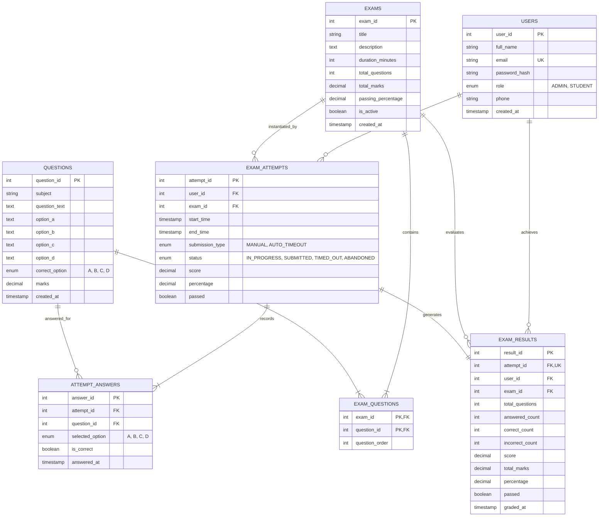
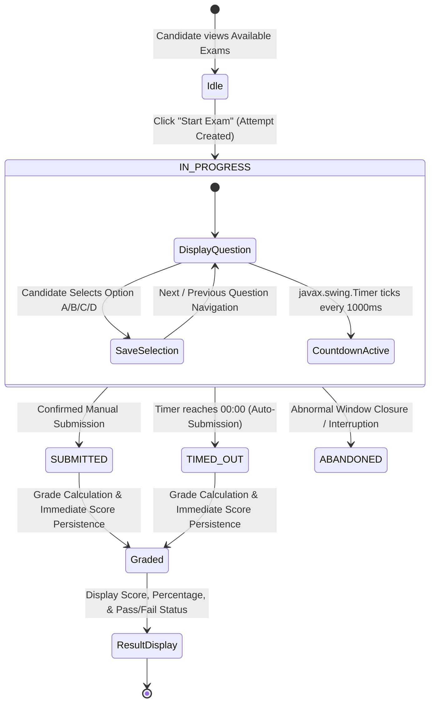

# Qveto Online Examination System — Week 1 Engineering Deliverables

## 1. Overview & System Context
The **Qveto Online Examination System** (Project 3) is a robust, desktop-based assessment platform built with **Java Swing** and **MySQL**. It enables administrators to author reusable question banks and administer timed examinations, while students securely take assessments with automatic countdowns, real-time answer persistence, and automated scoring.

---

## 2. System Architecture & Layered Package Structure
Following strict separation of concerns, the application is organized into modular layers:

```
src/main/java/com/qveto/exam/
├── Main.java               # Application Bootstrap & EDT Initialization
├── model/                  # POJOs / Entities
│   ├── User.java           # Admin & Student user records
│   ├── Role.java           # ADMIN, STUDENT enum
│   ├── Exam.java           # Examination configuration entity
│   ├── Question.java       # Multiple-choice question bank entity
│   ├── ExamAttempt.java    # Candidate test attempt session
│   ├── AttemptStatus.java  # IN_PROGRESS, SUBMITTED, TIMED_OUT, ABANDONED
│   ├── SubmissionType.java # MANUAL, AUTO_TIMEOUT
│   ├── AttemptAnswer.java  # Persistent option selection
│   └── ExamResult.java     # Graded evaluation and performance metric
├── dao/                    # JDBC Data Access Layer (PreparedStatements)
│   ├── UserDAO.java        # Secure authentication & user CRUD
│   ├── ExamDAO.java        # Examination queries & creation
│   ├── QuestionDAO.java    # Reusable question bank management
│   ├── AttemptDAO.java     # Session tracking & live answer persistence
│   └── ResultDAO.java      # Score persistence and grade reports
├── service/                # Business Logic & Timing Rules
│   ├── AuthService.java    # Authentication, password checks & offline demo fallback
│   └── ExamService.java    # Exam distribution, grading rules & attempt initialization
├── validation/             # Input Validation
│   ├── InputValidator.java # Email regex, password length, boundaries
│   └── ValidationResult.java # Error collection and status object
├── util/                   # Shared Infrastructure & Helpers
│   ├── DBConnection.java   # Externalized JDBC loader with diagnostic polling
│   ├── PasswordUtil.java   # SHA-256 secure password hashing & verification
│   ├── SessionManager.java # Thread-safe active user session container
│   └── AppConstants.java   # Theme colors, typography, CardLayout constants
└── ui/                     # Java Swing Presentation Layer
    ├── MainFrame.java      # Top-level window hosting CardLayout navigation
    ├── LoginPanel.java     # Authentication screen with quick-fill demo buttons
    ├── RegisterPanel.java  # Student account self-registration
    ├── AdminDashboardPanel.java   # Week 1 Admin overview & exam management shell
    └── StudentDashboardPanel.java # Week 1 Student portal & instructions shell
```

---

## 3. Entity-Relationship (ER) Diagram



---

## 4. Exam Attempt Lifecycle & Session State Diagram



---

## 5. Week 1 Implementation Status
- [x] **Project Skeleton:** Maven standard directory layout (`src/main/java`, `src/main/resources`, `src/test/java`, `database`).
- [x] **Database Schema:** Production-grade DDL in `database/schema.sql` covering users, exams, reusable question bank, mappings, attempts, answers, and results.
- [x] **Synthetic Seed Data:** `database/seed.sql` with default admin, student accounts, sample MCQs across subjects, and exams.
- [x] **Secure Persistence:** PreparedStatements everywhere in DAO layer; SHA-256 password hashing in `PasswordUtil`.
- [x] **CardLayout Navigation:** `MainFrame` managing seamless switching between Login, Register, Admin Dashboard, and Student Dashboard.
- [x] **Input Validation:** Centralized boundary checks for names, email regex, passwords, and questions in `InputValidator`.
- [x] **Zero-Dependency Run & Test:** `run.bat` and `test.bat` for one-click compilation, execution, and verification.
- [x] **Automated Tests:** 20 unit tests covering password security, input boundaries, entity models, and authentication workflows.
