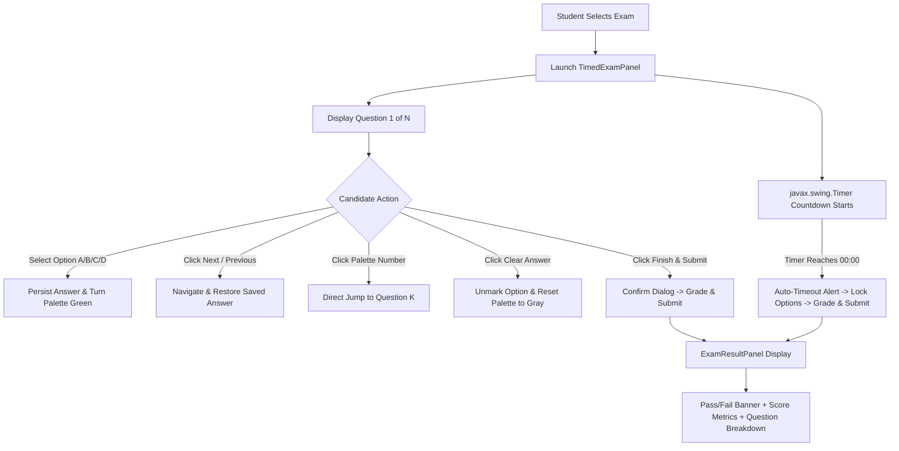

# Qveto Online Examination System — Week 3 Engineering Deliverables

## 1. Overview & Objectives (Week 3 Milestone)
In accordance with the **Project 3: Online Examination System** roadmap, Week 3 implements the core assessment engine:
- **One-Question-at-a-Time Exam UI**: Sequential question display with Next/Previous navigation and question counter.
- **Visible Countdown Timer**: Real-time timer powered by `javax.swing.Timer` counting down every 1000ms with progressive alert color transitions (Blue $\rightarrow$ Amber at 5m $\rightarrow$ Red at 1m).
- **Interactive Question Palette / Navigator**: Direct-access grid displaying live candidate progress (Green for Answered, Blue for Current Question, Gray for Unanswered).
- **Real-Time Answer Persistence**: Options saved dynamically as candidate navigates or changes selections, preventing data loss.
- **Submission Controls**: Confirmed manual submission dialog and automatic timeout submission upon expiry.
- **Post-Submission Tamper Protection**: Radio buttons and navigation controls immediately disabled upon submission/timeout.
- **Automated Score Calculation & Review**: Instant score, percentage, pass/fail grading, and question-by-question performance review.

---

## 2. Components & Architecture

```
src/main/java/com/qveto/exam/
├── ui/
│   ├── TimedExamPanel.java      # Active test-taking screen with timer, palette & answer persistence
│   ├── ExamResultPanel.java     # Scored outcome view, pass/fail banner & question review table
│   ├── StudentDashboardPanel.java # Launches timed test session via startExam()
│   └── MainFrame.java           # CardLayout coordinator with CARD_TIMED_EXAM and CARD_RESULT
├── service/
│   └── ExamService.java         # Added startAttempt(), recordAnswer(), and gradeAttempt() with SubmissionType
└── util/
    └── AppConstants.java        # Added CARD_TIMED_EXAM, CARD_RESULT, and COLOR_WARNING
```

---

## 3. Workflow & Technical Highlights



---

## 4. Test Verification Summary
All 32 automated unit tests across 6 suites executed with zero failures:
- `PasswordUtilTest`: 5 passed
- `InputValidatorTest`: 6 passed
- `ModelTest`: 4 passed
- `AuthServiceTest`: 5 passed
- `ExamServiceTest`: 7 passed
- `TimedExamWorkflowTest`: 5 passed
- **Total: 32 tests passed (100% pass rate).**
