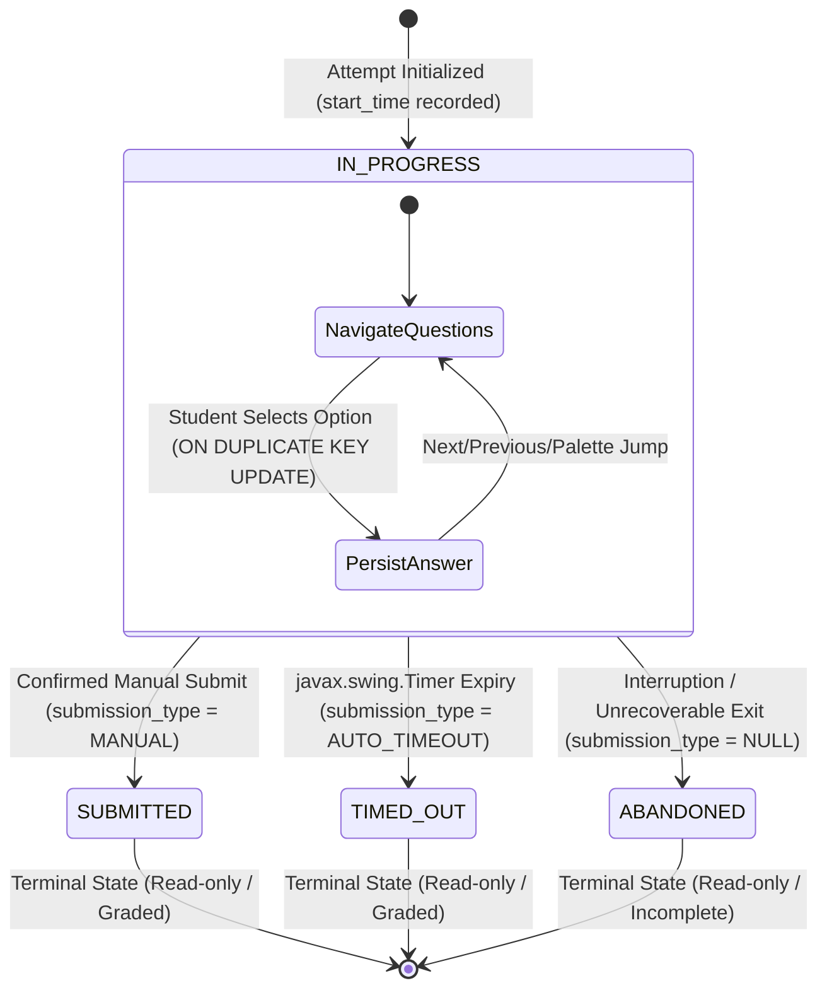

# 🔄 Exam Attempt Session Lifecycle & State Machine
**Module:** Assessment Session Persistence & Security  
**Owner:** Member 2 (Database & Persistence Engineer)  
**Specification:** Qveto Technologies SOP v1.1 — Project 3 (Week 3 Milestone)

---

## 1. Overview
The online examination system requires atomic state management to protect assessment integrity. Students cannot alter answers after submission, and sessions must be cleanly tracked whether ended by confirmed manual submission or automatic countdown expiry.

---

## 2. State Transition Model



---

## 3. State Definitions & Rules

| State | Submission Type | `end_time` | Modifiable? | Description |
| :--- | :--- | :--- | :--- | :--- |
| **`IN_PROGRESS`** | `NULL` | `NULL` | **YES** | Student is actively taking the test; answers are continuously upserted into `attempt_answers`. |
| **`SUBMITTED`** | `'MANUAL'` | `TIMESTAMP` | **NO** | Candidate reviewed questions and clicked "Finish & Submit". Session is locked immediately. |
| **`TIMED_OUT`** | `'AUTO_TIMEOUT'` | `TIMESTAMP` | **NO** | Visible countdown reached 00:00. Swing timer automatically triggers locked submission. |
| **`ABANDONED`** | `NULL` | `TIMESTAMP` | **NO** | Window closed or system interrupted without standard submission confirmation. |

---

## 4. Database Constraints & Enforcement

In `database/schema.sql`:
```sql
CHECK (status IN ('IN_PROGRESS', 'SUBMITTED', 'TIMED_OUT', 'ABANDONED')),
CHECK (submission_type IS NULL OR submission_type IN ('MANUAL', 'AUTO_TIMEOUT'))
```

In `AttemptDAO.java`:
- Before accepting answer upserts or scoring, verify `attemptDAO.isAttemptActive(attemptId)`.
- Terminal states reject any post-submission answer modification.
